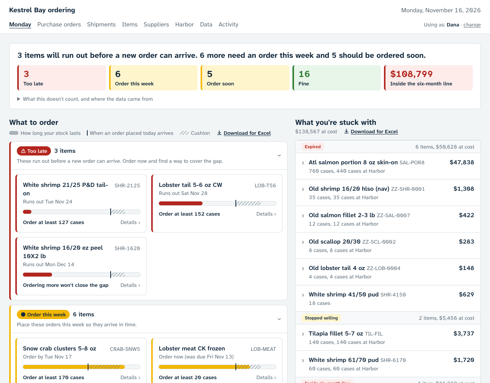
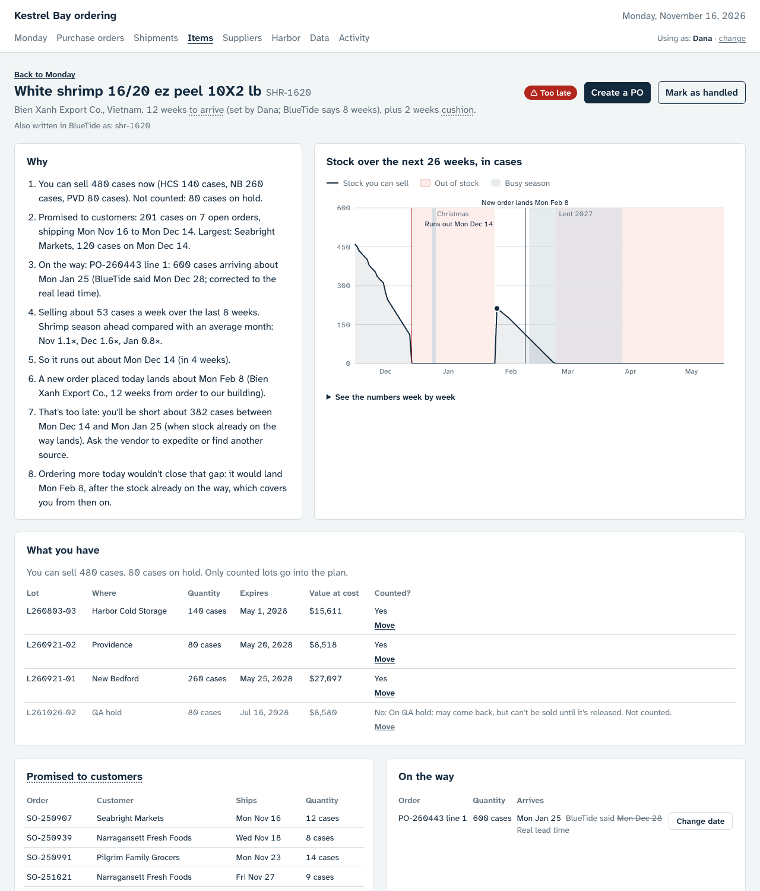
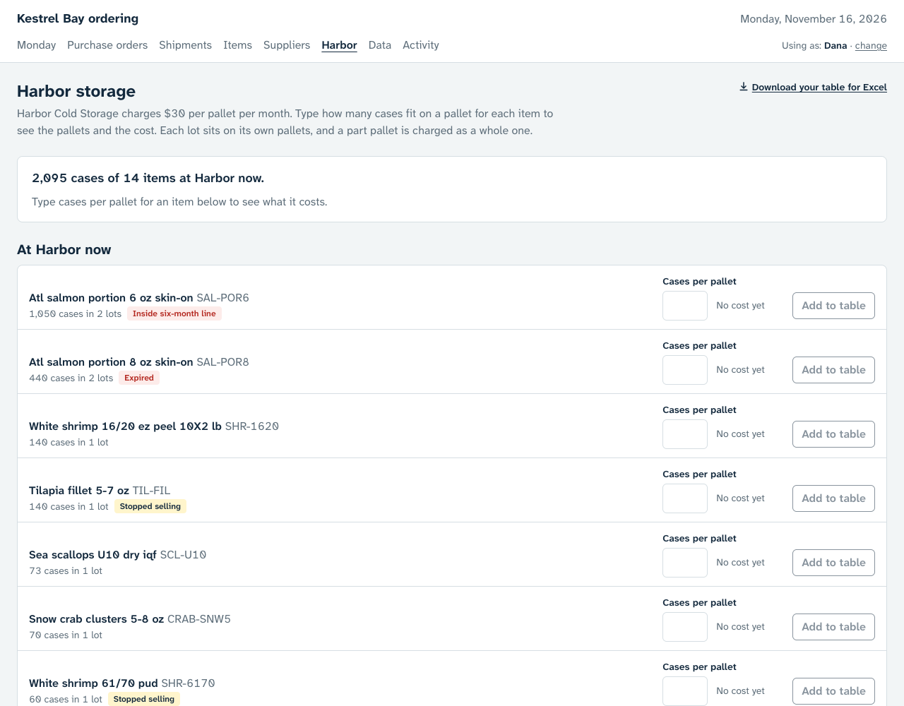
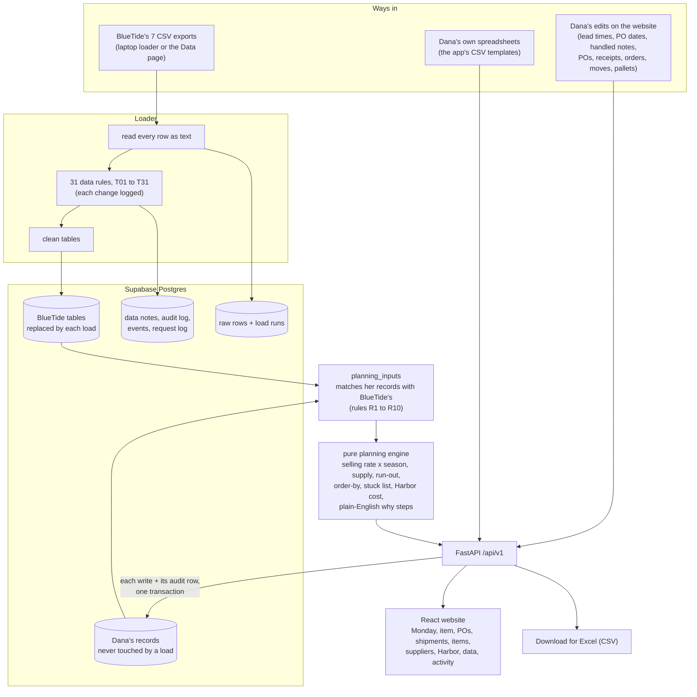

# Kestrel Bay ordering

A web app for **Dana Okafor, VP Purchasing at Kestrel Bay Seafood** (a frozen seafood distributor in New Bedford). On
Monday morning it answers her two questions on one screen:

1. **What will run out before a new order can arrive?**
2. **What am I stuck with?** That means stock inside the six-month line, expired or dead stock, and long stock at Harbor
   Cold Storage, which charges by the pallet.

It counts only stock she can sell and real customer demand. Every number clicks through to the lots, orders and POs
behind it. Dana can also tell it what it doesn't know: real lead times, a PO's real arrival date, or "I've handled
this one". Since Phase 6 it is also where she logs her own work: POs through to received, orders going out, stock
moves, next week's BlueTide files and her own spreadsheets. It works with or without BlueTide.



**Live:** https://nammu-ai.vercel.app (API docs at https://nammu-ai.vercel.app/api/v1/docs)

> "Today" is fixed at **Monday, Nov 16, 2026**, the day after BlueTide's last stock count (`AS_OF_DATE`). Every date
> and number is worked out from that day, not from your computer's clock.

---

## Use it in one minute
1. Open the link and type your name. It goes on every change you make (there are no logins in v1, ADR-011).
2. Read the top line: *"3 items will run out before a new order can arrive. 6 more need an order this week and 5
   should be ordered soon."* The colours:
   - **red** = too late;
   - **yellow** = order this week (solid) or soon (light);
   - **green** = fine;
   - **grey** = handled.
3. Under **Too late**, click **White shrimp 16/20 (SHR-1620)**, then **See why and all the numbers**. You'll see
   eight plain steps:
   - 480 cases she can sell;
   - 201 promised to customers;
   - 600 on the way, which BlueTide dates Dec 28 but really arrive about Jan 25;
   - about 53 a week selling, with December running 1.6× a normal month;
   - it runs out about Dec 14, and a new order would land Feb 8, so it's too late.
   Next to the steps are a 26-week chart and every lot.
4. On the right of Monday, **What you're stuck with**: the Chilean salmon portions (SAL-POR6), 1,350 cases, 1,050 of
   them at Harbor, **$81,232 at cost inside the six-month line**.
5. **Data → What we cleaned up and why**: all 4,047 rows of BlueTide data the app corrected or left out, each with
   its file and line.

A 10-minute walkthrough for Dana is in [`docs/DEMO_SCRIPT.md`](docs/DEMO_SCRIPT.md).

| SHR-1620: why it's too late | Harbor storage cost |
|---|---|
|  |  |

---

## What's in it
| Page | What Dana does there |
|---|---|
| **Monday** | Reads the two answers. What to order is grouped as Too late / Order this week / Order soon, then Handled, Late or unknown, and Fine. The stuck list is grouped by problem, with dollars. "Create a PO" and "Download for Excel" are on the page. |
| **Item** (click any item) | Sees the eight "why" steps, the chart, every lot (counted or not, and why), promised orders and what's on the way. Marks it handled, sets a PO's real date, moves a lot, creates a PO. |
| **Purchase orders** | BlueTide's POs and hers in one list. New PO; then ship, receive (lot, expiry, building), cancel or undo. |
| **Shipments** | Orders going out. Open ones count as promised; shipping takes stock, soonest to expire first. (Stock moves between buildings are logged from the item page or the stuck list.) |
| **Items / Suppliers** | Adds her own items and suppliers. Sets lead times and cushion in weeks ("BlueTide says 8 weeks, you say 12"). |
| **Harbor** | Types how many cases fit on a pallet and sees pallets and dollars a month at $30 a pallet. Keeps a table to download. |
| **Data** | Loads next week's BlueTide files, or her own spreadsheets from the app's templates. A check comes first and changes nothing until she presses Load. Shows every data note. |
| **Activity** | Every change: who, when, and before and after. |

---

## How it works


**In words:**
- **Loading.** The loader reads BlueTide's seven exports as text, keeps every raw row, and applies one rule per known
  data problem. Every row it corrects or leaves out is written down with its file, line and reason, as a data note.
  A load is one transaction (all or nothing) and never touches Dana's own records.
- **Planning.** The planning engine (`backend/app/planning/`) is pure: no database, no clock, no I/O. So every rule has
  a unit test, and the same inputs always give the same answer. For each item:
  - **Sellable stock:** the latest count, in a sellable building, not expired, not on hold or damaged.
  - **Selling rate:** the last 8 weeks of real demand, adjusted by the category's month-by-month season (shrimp 1.6×
    in December, groundfish 2.0× in March for Lent). Real demand means no transfers, samples, credits, cancellations,
    or the one-off cruise order.
  - **Supply:** promised orders are taken out on their ship dates. POs count on a re-derived arrival date: never
    earlier than order date + the real lead time. Late POs count as nothing until Dana types a date.
  - **The day it runs out,** compared with when an order placed today would land (lead time, plus a cushion).
- **Statuses:**
  - **Too late:** it runs out before a new order can land.
  - **Order this week:** the order-by date is within 7 days.
  - **Order soon:** within 21 days.
  - **"Order at least":** enough to cover from the order's arrival until next Monday's order could arrive, plus the
    cushion.
- **Stuck:**
  - expired;
  - stopped selling (no sales in 60 days, a legacy ZZ item, or Dana says discontinued);
  - inside the six-month line;
  - more than 12 weeks of supply at Harbor;
  - more than 26 weeks of supply (overstock).
- **The "why" steps** are generated from the same numbers.
- **Dana's records** (POs, receipts, orders, moves, stock counts, sales) are matched with BlueTide's by document and
  quantity, never counted twice (ADR-027/028). Where both have a record, hers is the main one, except a BlueTide
  receipt, which wins over an open line in the app (Ishan's rule).
- **All business numbers** live in one file, `backend/app/config/business_rules.py`, each with its source, plus the
  human-maintained seeds in `data/reference/`. The API lists them with their sources at `/api/v1/settings`.

**Stack:**
- **Backend:** Python 3.12, FastAPI, SQLAlchemy 2 and Alembic on Supabase Postgres.
- **Website:** React 18, Vite and TypeScript (strict), with Tailwind 4, TanStack Query and Recharts.
- **Hosting:** one Vercel project with two services, website and API on one domain (ADR-002). There's a daily cron
  on `/api/v1/health` so Supabase never pauses.

---

## Key assumptions
Every default, where it came from, and whether Dana confirmed it: [`docs/ASSUMPTIONS.md`](docs/ASSUMPTIONS.md)
(A01–A48). The ones that move the numbers most:
- **Lead times are the upper end of Dana's ranges:** Vietnam 12 weeks (BlueTide says 8), Chile 6, Canada 2, Alaska 4,
  Maine 3, plus a cushion of 2 weeks for imports and 1 week otherwise. Dana confirmed these by email.
- **A late PO is not counted as coming** until Dana types a real date. Items only a late PO would cover are called
  out (Dana's reply, replacing the email's "assume a week").
- **QA hold is shown, never counted** (Walt: "If I can't sell it, it isn't inventory"; Dana confirmed).
- **Age comes from the expiry date only.** Received dates aren't age: the Chilean salmon was packed a year before it
  arrived (T30).
- **Open customer orders count once,** taken out on their ship date and not added to the selling rate (Ishan, A23).
  The build spec said to do both.
- **Harbor:** $30 per pallet per month (Dana). Each lot sits on its own pallets and a part pallet is charged whole
  (A47). Cases per pallet is Dana's number and is never guessed.
- **When in doubt, the app picks whatever makes a stockout less likely,** and says so.

**Versus the answer key** in the build spec (`scripts/compare_answer_key.py`, run with the backend's virtualenv):
- The stuck list and the "not counted" totals match the key's facts.
- SHR-1620 runs out Dec 14 in both.
- The other run-out dates move because of the two decisions above: counting open orders once, and not counting late
  POs.
- With open orders counted the spec's way, every run-out date is within 0–4 days of the key, though two items then
  tip from "this week" to "too late" by a day.
- The order list also has CAL-RING (only a late PO covers it) and SHR-1215 (order-by Nov 20, just inside this
  week).

The script prints the scenarios side by side. The logic was never tuned to the key.

---

## Data problems found, and how they're handled
BlueTide's exports have 31 known problems, each with a rule, a test named after it, and a section in
[`docs/DATA_AUDIT.md`](docs/DATA_AUDIT.md). The files themselves are never changed. Instead, every correction is
logged, and Dana can browse all of them on the **Data** page. The latest load produced **4,047 data notes**: 3,842
rows left out, 145 corrected, 60 flagged for her.

| Problem | What the app does |
|---|---|
| Two nights of stock in one file (T01) | Uses only the latest night (115 older rows set aside) |
| Item codes typed different ways, duplicate item rows (T02, T03) | Reads `shr-1620 ` as SHR-1620 and keeps the spelling as an alias (78 rows) |
| Cases and pounds mixed (T10) | Converts with a pack-size table a person checked |
| "Locations" that are really QA hold or damaged (T11) | Shown, never counted |
| Transfers between buildings recorded as sales (T16) | Not demand (378 rows) |
| Samples as $0 orders, credits as negative sales, cancelled sales (T17–T19) | Not demand (104, 76 and 294 rows) |
| The one-off cruise line order (T20) | Kept out of the selling rate |
| Stockout weeks hiding true demand (T23) | Last December's SHR-1620 stockout is left out of the selling rate |
| PO dates that can't be right (T26), lead times missing or wrong (T27) | Arrival re-derived from the real lead time; Dana's numbers win |
| Legacy ZZ items and quietly dead items (T05, T06) | Stock flagged as stuck, never reordered |

---

## Out of scope, with reasons
- **Fresh and day-boat ordering:** daily and separate, and Dana says she doesn't need help ("Fresh is out for now").
- **Marco's features** (availability and price for a customer, route planning, emails): "Dana first". Prices are
  loaded, so phase 2 starts from clean data.
- **A direct BlueTide connection:** BlueTide is ancient with no known API. Dana uploads its exports on the Data page
  instead, and the loader's rules are pure functions a nightly feed could reuse.
- **Sending POs to suppliers** (email, EDI). Dana creates and tracks POs in the app (Phase 6) but still sends them by
  phone and email.
- **Transfer suggestions between buildings:** no capacity data yet. Moves can be logged, and Harbor now has a cost.
- **Statistical or machine-learning forecasting:** only one year of history, and a skeptical Dana needs to see why.
  Worth revisiting with 2+ years.
- **User accounts and roles:** one user, fictional data. The name prompt goes on every change for now.
- **A native mobile app:** the website works at phone width.
- **Pricing, margin and customer analytics:** not asked for.
- **A chat assistant:** Ishan's idea for later ("why is the 16/20 shrimp red?" answered from the same "why" steps).
- **Multi-tenant support for other Nammu clients:** the code keeps config separate, so it's possible later.

---

## What I'd do next
From [`docs/PRIORITIES.md`](docs/PRIORITIES.md) (P1, in order):
1. A **"what if the QA hold clears"** switch: an on-hold lot is shown separately today; this would show the plan with it.
2. **Stock projected to expire before it sells,** lot by lot (soonest to expire first).
3. **A stockout detector:** suggest zero-sales runs for Dana to confirm, so stockouts don't drag the rate down.
4. **Order rounding** to supplier minimums or container sizes, once we have them.
5. Easter-aligned Lent, editable thresholds on screen, and a simple passcode.

**Then:**
- **Switch "today" to the real date.** Dana's dates that pass would become late, and her new sales would start feeding
  the selling rate.
- **The chat assistant.**

**Scaling it** to more data, more users or more clients:
- a nightly BlueTide feed, reusing the loader's rules;
- logins (Supabase Auth) once a second person edits;
- loads in a background job, for files over 4.4 MB;
- caching the plan per load and per edit (today it's worked out again on each request; the engine itself takes
  about 60 ms for all items);
- per-client config for the reference seeds and business rules.

---

## How I used AI
**Tools:**
- **Claude in claude.ai** for the up-front work: the data audit (31 traps, 17 "golden" facts), the strategy, the
  answer key, and the email to Dana with a default for every question. These are entries #0.1–#0.3 in the log.
- **Claude Code** for the build.
- I wrote and decided the spec ([`BUILD_PROMPT.md`](BUILD_PROMPT.md)). Claude Code implemented it, explained it and
  flagged problems. Every business rule I decided is recorded with my name in DECISIONS or ASSUMPTIONS.

**Workflow:**
- Work went in phases with a stop after each: Claude posted a plan, I said "go".
- Small conventional commits.
- One test per data trap, plus golden tests on the real data.
- A headless-browser click-through with screenshots at desktop and phone width (1280 and 375 px).
- A smoke test on the live site after every deploy.
- [`CLAUDE.md`](CLAUDE.md) carries the rules Claude must follow each session:
  - "today" is fixed;
  - never touch the raw files;
  - business numbers live in one file;
  - pick the conservative option and record it;
  - never tune to the answer key.
- **Every prompt is logged** in [`docs/PROMPT_LOG.md`](docs/PROMPT_LOG.md): what changed, the impact, who decided, and
  the AI's mistakes.

**Where the AI was wrong, and how it was caught:**
- **The answer key itself was wrong at first.** In the planning chat, Claude's first run took every open customer
  order out of stock on day one, which made the snow crab look too late. It was corrected before the build started,
  and became rule T22: take an order out on its ship date.
- **A config file would have broken the deploy.** Claude had added a `pyproject.toml` for tool settings. Reading
  Vercel's build code showed that any `pyproject.toml` replaces `requirements.txt`. It was caught before deploying,
  and a test now guards it.
- **The loader wiped data it shouldn't have.** The first writer dropped every field named `source`, including the
  seeds' provenance text. The database's NOT NULL check caught it on the first real load, and the transaction rolled
  back, leaving nothing behind.
- **A wrong shortage explanation.** SHR-1620's first "why" said the gap lasted until the new order (Feb 8). The PO
  already on the way restocks Jan 25, and "order at least 0" looked like a bug. Claude caught it reviewing the
  output against the data, and the "back in stock" date was added.
- **The chart showed "−1,200 cases".** The engine uses negatives to measure a shortage, but a shelf can't hold
  negative stock. It was caught in the screenshots, and the chart now stops at zero with an out-of-stock band.
- **It built only what the spec said.** The spec scoped analysis of one load. I expected a system Dana can log her
  work in, and Claude should have raised that gap at the Phase 5 plan. I caught it in review, and it became Phase 6.
- **A design that would have double-counted.** The first plan for matching Dana's records with BlueTide's used a date
  cut-off. A design review against the code showed that BlueTide's receipts have no date. Records are now matched by
  document and quantity (rules R1–R10, each with a test).
- **Edits that silently didn't apply.** A find-and-replace missed because the formatter had reshaped the code, so a
  new customer didn't appear after it was added. The browser click-through caught it, and every replacement now
  checks it matched.
- **Hover definitions that wouldn't go away.** A shared CSS group class made every definition appear when a card
  opened. I caught it in a screenshot, and every dropdown now has its own named group.

---

## Run it locally
**Backend** (Python 3.12):
```bash
cd backend && python3.12 -m venv .venv && source .venv/bin/activate
pip install -r requirements.txt -r requirements-dev.txt
cp .env.example .env                          # paste the Supabase session pooler URL (port 5432) into DATABASE_URL
python3 ../scripts/set_database_password.py   # puts the password in safely (hidden, URL-encoded)
alembic upgrade head                          # create/upgrade tables (RLS on every table)
python -m app.loader.run                      # load the BlueTide CSVs (~2 min; safe to re-run; writes docs/DATA_LOAD_REPORT.md)
uvicorn app.main:app --reload                 # API on http://localhost:8000, docs at /api/v1/docs
```

**Website** (Node 22.12 or newer):
```bash
cd frontend && npm install && npm run dev     # http://localhost:5173 (forwards /api to :8000)
```

**Tests and checks:**
```bash
cd backend && pytest && ruff check . && ruff format --check .   # never touches the real database (SQLite copy, ADR-023)
cd frontend && npm run build && npm run lint && npm run format:check
shasum -a 256 -c data/raw_checksums.sha256    # the raw files are byte-identical to the client's
python3 scripts/profile_data.py               # independent re-check of the audit's facts
python3 scripts/compare_answer_key.py         # the engine next to the spec's answer key (backend venv)
```

**Deploy:**
- **The project:** one Vercel project from the repo root. `vercel.json` declares the `web` (frontend/) and `api`
  (backend/) services. A push to `main` deploys.
- **Environment variables:** `DATABASE_URL` (the Supabase *transaction* pooler, port 6543) and `APP_ENV=production`.
- **Migrations and the first load** run from a laptop through the session pooler, never on deploy.
- **The daily cron** (`/api/v1/health`, 12:00 UTC) shows under Vercel → Project → Settings → Cron Jobs. Each call is
  logged with actor "Vercel cron": `python ../scripts/check_cron.py`.

---

## Where things are
| | |
|---|---|
| [`BUILD_PROMPT.md`](BUILD_PROMPT.md) | The spec, and the source of truth (later decisions override it where noted in CLAUDE.md) |
| [`CLAUDE.md`](CLAUDE.md) | The short version: rules, invariants, code map, live-change playbook |
| [`docs/DECISIONS.md`](docs/DECISIONS.md) | ADR-001 to ADR-031 |
| [`docs/ASSUMPTIONS.md`](docs/ASSUMPTIONS.md) | Every default and its status |
| [`docs/DATA_AUDIT.md`](docs/DATA_AUDIT.md) | The 31 data traps and 17 golden facts |
| [`docs/DATA_LOAD_REPORT.md`](docs/DATA_LOAD_REPORT.md) | What the last laptop load did |
| [`docs/PRIORITIES.md`](docs/PRIORITIES.md) | P0 (done), P1, P2 |
| [`docs/PROMPT_LOG.md`](docs/PROMPT_LOG.md) | Every prompt, change and AI mistake |
| [`docs/DEMO_SCRIPT.md`](docs/DEMO_SCRIPT.md) | The 10-minute walkthrough for Dana |
| [`docs/client/`](docs/client/) | The assignment, kickoff transcript, the email to Dana and her replies |
| [`kestrel-bay/`](kestrel-bay/) | The client's original files, untouched (working copies in `data/raw/`) |
