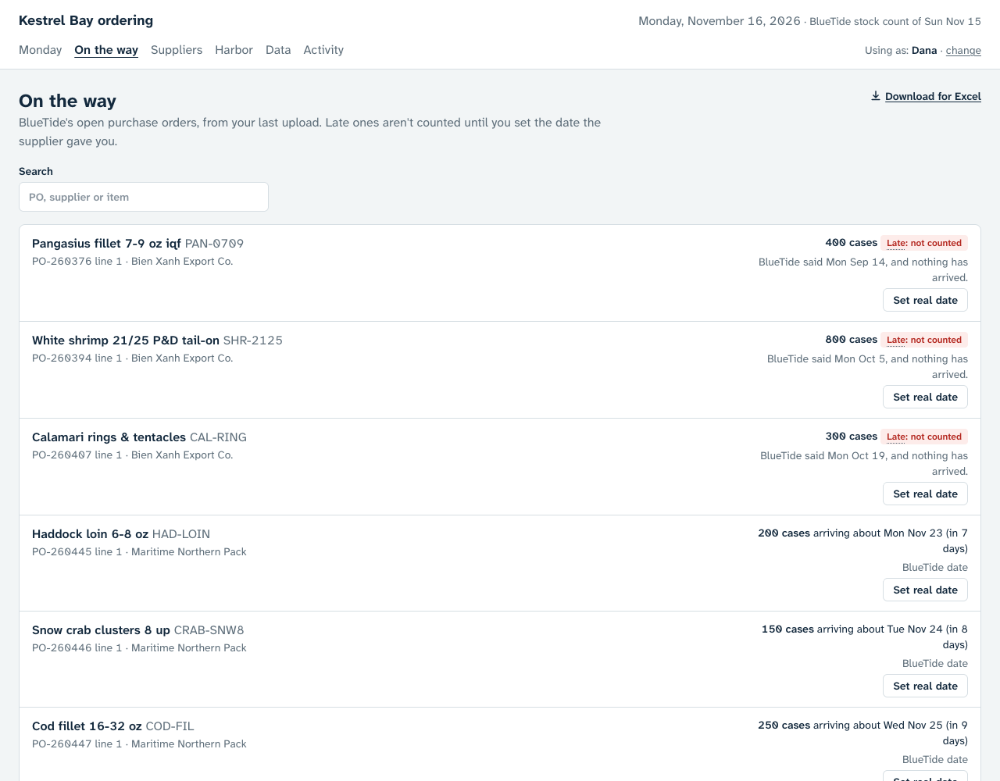
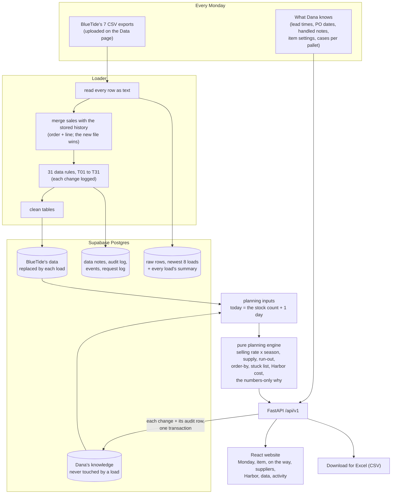

# Kestrel Bay ordering

A web app that **replaces Dana Okafor's Monday spreadsheet**. Dana is VP Purchasing at Kestrel Bay Seafood, a frozen
seafood distributor in New Bedford. Every Monday she uploads BlueTide's exports, everything recalculates, and one
screen answers her two questions:

1. **What will run out before a new order can arrive?**
2. **What am I stuck with?** That means stock inside the six-month line, expired or dead stock, and long stock at Harbor
   Cold Storage, which charges by the pallet.

It counts only stock she can sell and real customer demand, and every number clicks through to the lots, orders and
POs behind it. **BlueTide stays the system of record.** The app stores only what BlueTide doesn't know: real lead
times, a PO's real arrival date, "I've handled this one", and how many cases fit on a pallet.


**Live:** https://nammu-ai.vercel.app (API docs at https://nammu-ai.vercel.app/api/v1/docs)

> "Today" follows the data: it's the day after the latest BlueTide stock count that was loaded. The current files
> are Sunday Nov 15's count, so today is **Monday, Nov 16, 2026**. Next week's upload moves it to Nov 23. The
> computer's clock is never used.

---

## What I built: the weekly loop
1. **Upload (Data page).** Dana drops in BlueTide's seven exports; any she leaves out reuse last week's copy. A check
   runs first and changes nothing. It shows:
   - what "today" will become;
   - how the sales file merged with the history (new, changed, kept);
   - anything that looks wrong (an older stock count is blocked; the same night twice is a warning).

   Then she presses Load. Sales history builds up across uploads, so an export of recent weeks never loses the year
   the season pattern needs.
2. **Look (Monday).** The two answers, most urgent first:
   - What to order is grouped as Too late / Order this week / Order soon, then Handled, Late or unknown, and Fine;
   - the stuck list is grouped by problem, with dollars at cost.

   Click any item for the **why, as numbers**, one row per number the engine used, each linking to the table that
   holds its source rows:
   - can sell, not counted, promised, on the way, late;
   - selling per week, the season ahead;
   - runs out, when a new order lands, short, order at least.
3. **Adjust.** Tell it what BlueTide doesn't know:
   - a supplier's real lead time and cushion (Suppliers);
   - a late PO's real date (On the way, or on the item);
   - "I've handled this one", with a quantity and date if she's ordered;
   - cases per pallet (Harbor).

   Every change is audited.
4. **Order.** She orders the way she does today, by phone and in BlueTide. Next Monday's upload brings the PO in, and
   her handled note offers to clear itself.

| SHR-1620: why it's too late, as numbers | On the way: BlueTide's open POs, late ones first |
|---|---|
|  |  |

### Use it in one minute
1. Open the link and type your name. It goes on every change you make (there are no logins in v1, ADR-011).
2. Read the top line: *"3 items will run out before a new order can arrive. 6 more need an order this week and 5
   should be ordered soon."* The colours:
   - **red** = too late;
   - **yellow** = order this week (solid) or soon (light);
   - **green** = fine;
   - **grey** = handled.
3. Under **Too late**, click **White shrimp 16/20 (SHR-1620)**, then **See why and all the numbers**:
   - can sell **480** (80 on hold not counted);
   - promised **201** (largest: Seabright, 120 on Dec 14);
   - on the way **600** on PO-260443, Jan 25 (BlueTide says Dec 28, but 12 weeks from Vietnam won't allow it);
   - selling **53 a week**, December **1.6×**;
   - runs out **Dec 14**; a new order lands **Feb 8**, so it's **short 382 until Jan 25**.
4. Open **SHR-2125**. Only a late PO would cover it, so it gives one instruction: *"Order at least 127 cases, unless
   PO-260394 (800 cases) is really coming. Ask the supplier for its date and set it here, and these numbers update."*
5. **What you're stuck with:** the Chilean salmon portions (SAL-POR6), 1,350 cases, 1,050 of them at Harbor,
   **$81,232 at cost inside the six-month line**.

A 10-minute walkthrough for Dana is in [`docs/DEMO_SCRIPT.md`](docs/DEMO_SCRIPT.md).

| Page | What Dana does there |
|---|---|
| **Monday** | Reads the two answers; opens a card for its numbers; marks an item handled; downloads either list for Excel. |
| **Item** (click any item) | Reads the numbers-only why, the 26-week chart, every lot (counted or not, and why), promised orders, what's on the way and what's late. Sets a PO's real date, marks it handled, changes its cushion. |
| **On the way** | BlueTide's open PO lines from the last upload: our date, BlueTide's date, late ones first. "Set real date". Read only otherwise. |
| **Suppliers** | Time to arrive and cushion per supplier, in weeks ("BlueTide says 8 weeks, you say 12"). |
| **Harbor** | Types how many cases fit on a pallet; sees pallets and dollars a month at $30 a pallet; keeps a table to download. |
| **Data** | The weekly upload (check, then load), past uploads, and every data note: what the loader corrected or left out, with file and line. |
| **Activity** | Every change: who, when, and before and after. |

---

## How it works


**In words:**
- **Loading.** The loader reads BlueTide's seven exports as text and keeps every raw row (for the newest 8 loads). It
  merges the sales file with the stored history, then applies one rule per known data problem.
  - Every row it corrects or leaves out is written down with its file, line and reason, as a data note.
  - A load is one transaction (all or nothing) and never touches Dana's knowledge.
  - "Today" for a load is the day after its own stock count.
- **Planning.** The planning engine (`backend/app/planning/`) is pure: no database, no clock, no I/O, and no AI. So
  every rule has a unit test, and the same inputs always give the same answer. For each item:
  - **Sellable stock:** the latest count, in a sellable building, not expired, not on hold or damaged.
  - **Selling rate:** the last 8 weeks of real demand, adjusted by the category's month-by-month season (shrimp 1.6×
    in December, groundfish 2.0× in March for Lent). Real demand means no transfers, samples, credits, cancellations,
    or the one-off cruise order.
  - **Supply:** promised orders are taken out on their ship dates. POs count on a re-derived arrival date: never
    earlier than order date + the real lead time. Late POs count as nothing until Dana types a date.
  - **The day it runs out,** compared with when an order placed today would land (lead time, plus a cushion).
- **Statuses:**
  - **Too late:** it runs out before a new order can land.
  - **Order this week:** the order-by date is within 7 days.
  - **Order soon:** within 21 days.
  - **"Order at least":** enough to cover from the order's arrival until next Monday's order could arrive, plus the
    cushion.
- **Stuck:**
  - expired;
  - stopped selling (no sales in 60 days, a legacy ZZ item, or Dana says discontinued);
  - inside the six-month line;
  - more than 12 weeks of supply at Harbor;
  - more than 26 weeks of supply (overstock).
- **The chart and the why agree by test:** the chart's stock on any day = can sell − promised + arrivals − forecast +
  the sales lost while out of stock (they're lost, not paid back when stock lands).
- **All business numbers** live in one file, `backend/app/config/business_rules.py`, each with its source, plus the
  human-maintained seeds in `data/reference/`. The API lists them with their sources at `/api/v1/settings`.

**Stack:**
- **Backend:** Python 3.12, FastAPI, SQLAlchemy 2 and Alembic on Supabase Postgres.
- **Website:** React 18, Vite and TypeScript (strict), with Tailwind 4, TanStack Query and Recharts.
- **Hosting:** one Vercel project with two services, website and API on one domain (ADR-002). There's a daily cron
  on `/api/v1/health` so Supabase never pauses.

---

## What I cut, and why
In Phase 6 I made the app a **second system of record**. Dana could create POs, receive them into stock, log orders
going out, pick lots, move stock between buildings, and load her own spreadsheets of items, suppliers and stock
counts. It worked and was tested, but it was the wrong product:
- **Every PO, receipt and shipment would have been recorded twice,** in the app and in BlueTide. That meant double data
  entry for Dana's team, which nobody on the kickoff call asked for.
- **Keeping two records honest took ten matching rules (R1–R10), 12 extra tables and 17 extra assumptions** (in
  A27–A45). All of that existed only to avoid counting the same cases twice.
- **Fully replacing BlueTide isn't the fix either.** BlueTide also runs Marco's order entry, accounting's credits,
  warehouse receiving and transfers, and invoicing. Replacing part of it leaves Kestrel Bay on two systems; replacing
  all of it is an ERP migration.

So in my scope review I decided that **BlueTide stays the record, and the app replaces the Monday spreadsheet** (ADR-032).

**Cut:**
- the PO, receiving, shipment, stock-move, new-item and new-supplier screens and code;
- Dana's own templates;
- the 12 tables (migration 0006; on production they held only cancelled test records).

The code is preserved on the git tag `archive/system-of-record`.

**What came out of it:**
- the weekly loop above;
- "today" following the data;
- sales history that accumulates;
- storage that stays bounded;
- a read-only On the way page.

---

## Roadmap off BlueTide
If Kestrel Bay ever wants to retire BlueTide, do it **one job at a time, with each kind of record owned by exactly
one system at any moment** (never both):
1. **Purchasing first.** Dana already plans here. POs move into the app as the record:
   - created, sent and received here;
   - BlueTide's PO export stops being read;
   - BlueTide gets POs from the app (or a receiving clerk keys receipts here only).

   Most of the archived Phase 6 code is a head start.
2. **Then sales and receiving.** Marco's order entry, and the warehouse's receiving and transfers, move over the same
   way, each with a cut-over date after which only one system records it.
3. **BlueTide is retired last,** once credits and invoicing have a home (accounting's call, not Dana's).

---

## Key assumptions
Every default, where it came from, and whether Dana confirmed it: [`docs/ASSUMPTIONS.md`](docs/ASSUMPTIONS.md)
(A01–A51; A27–A45 retired with the cut). The ones that move the numbers most:
- **Lead times are the upper end of Dana's ranges:** Vietnam 12 weeks (BlueTide says 8), Chile 6, Canada 2, Alaska 4,
  Maine 3, plus a cushion of 2 weeks for imports and 1 week otherwise. Dana confirmed these by email.
- **A late PO is not counted as coming** until Dana types a real date. Items only a late PO would cover get one
  instruction (Dana's reply).
- **QA hold is shown, never counted** (Walt: "If I can't sell it, it isn't inventory"; Dana confirmed).
- **Age comes from the expiry date only.** Received dates aren't age: the Chilean salmon was packed a year before it
  arrived (T30).
- **Open customer orders count once,** taken out on their ship date and not added to the selling rate (Ishan, A23).
- **"Today" = the day after the latest stock count (A49).** **Sales history accumulates by order + line (A50).**
  **Raw rows are kept for the newest 8 loads (A51).**
- **Harbor:** $30 per pallet per month (Dana). Each lot sits on its own pallets and a part pallet is charged whole
  (A47).
- **When in doubt, the app picks whatever makes a stockout less likely,** and says so.

**Versus the answer key** in the build spec (`scripts/compare_answer_key.py`, run with the backend's virtualenv):
- The stuck list and the "not counted" totals match the key's facts.
- SHR-1620 runs out Dec 14 in both.
- The other run-out dates move because of two decisions: counting open orders once, and not counting late POs.
- With open orders counted the spec's way, every run-out date is within 0–4 days of the key, though two items then
  tip from "this week" to "too late" by a day.
- The order list also has CAL-RING (only a late PO covers it) and SHR-1215 (order-by Nov 20, just inside this week).

The script prints the scenarios side by side. The logic was never tuned to the key.

---

## Data problems found, and how they're handled
BlueTide's exports have 31 known problems, each with a rule, a test named after it, and a section in
[`docs/DATA_AUDIT.md`](docs/DATA_AUDIT.md). The files themselves are never changed. Instead, every correction is
logged, and Dana can browse all of them on the **Data** page. The latest load produced **4,047 data notes**: 3,842
rows left out, 145 corrected, 60 flagged for her.

| Problem | What the app does |
|---|---|
| Two nights of stock in one file (T01) | Uses only the latest night (115 older rows set aside) |
| Item codes typed different ways, duplicate item rows (T02, T03) | Reads `shr-1620 ` as SHR-1620 and keeps the spelling as an alias (78 rows) |
| Cases and pounds mixed (T10) | Converts with a pack-size table a person checked |
| "Locations" that are really QA hold or damaged (T11) | Shown, never counted |
| Transfers between buildings recorded as sales (T16) | Not demand (378 rows) |
| Samples as $0 orders, credits as negative sales, cancelled sales (T17–T19) | Not demand (104, 76 and 294 rows) |
| The one-off cruise line order (T20) | Kept out of the selling rate |
| Stockout weeks hiding true demand (T23) | Last December's SHR-1620 stockout is left out of the selling rate |
| PO dates that can't be right (T26), lead times missing or wrong (T27) | Arrival re-derived from the real lead time; Dana's numbers win |
| Legacy ZZ items and quietly dead items (T05, T06) | Stock flagged as stuck, never reordered |

---

## Out of scope, with reasons
- **Recording transactions in the app** (POs, receipts, shipments, moves, new items or suppliers). Cut, see above.
  It's the roadmap's first step if Kestrel Bay wants it.
- **A direct BlueTide connection:** BlueTide is ancient with no known API. Weekly uploads of its exports are the
  interface, and the loader's rules are pure functions a nightly feed could reuse.
- **Fresh and day-boat ordering:** daily and separate, and Dana says she doesn't need help ("Fresh is out for now").
- **Marco's features** (availability and price for a customer, route planning, emails): "Dana first". Prices are
  loaded, so phase 2 starts from clean data.
- **Statistical or machine-learning forecasting:** only one year of history, and a skeptical Dana needs to see why.
  Worth revisiting with 2+ years. There is no AI in the numbers.
- **User accounts and roles:** one user, fictional data. The name prompt goes on every change for now.
- **A native mobile app:** the website works at phone width.
- **Pricing, margin and customer analytics:** not asked for.
- **A chat assistant** (Ishan's idea for later): it could explain the same numbers-only rows, never compute them.
- **Multi-tenant support for other Nammu clients:** the code keeps config separate, so it's possible later.

---

## What I'd do next
From [`docs/PRIORITIES.md`](docs/PRIORITIES.md) (P1, in order):
1. A **"what if the QA hold clears"** switch: on-hold stock is shown separately today; this would show the plan with it.
2. **Stock projected to expire before it sells,** lot by lot (soonest to expire first).
3. **A stockout detector:** suggest zero-sales runs for Dana to confirm, so stockouts don't drag the rate down.
4. **Order rounding** to supplier minimums or container sizes, once we have them.
5. Easter-aligned Lent in the season pattern, editable thresholds on screen, and a simple passcode.

**Scaling it:**
- a nightly BlueTide feed in place of the upload, reusing the loader's rules;
- logins (Supabase Auth) once a second person edits;
- loads in a background job, for files over 4.4 MB;
- caching the plan per load and per edit (the engine takes about 60 ms for all items);
- per-client config for the seeds and business rules.

---

## How I used AI
**Tools:**
- **Claude in claude.ai** for the up-front work: the data audit (31 traps, 17 "golden" facts), the strategy, the
  answer key, and the email to Dana with a default for every question. These are entries #0.1–#0.3 in the log.
- **Claude in claude.ai again for my scope review** after Phase 6 (#34).
- **Claude Code** for the build.
- I wrote and decided the spec ([`BUILD_PROMPT.md`](BUILD_PROMPT.md)). Claude Code implemented it, explained it and
  flagged problems. Every business rule I decided is recorded with my name in DECISIONS or ASSUMPTIONS.

**Workflow:**
- Work went in phases with a stop after each: a plan first (in plan mode for the big ones), then my "go".
- Small conventional commits.
- One test per data trap, golden tests on the real data, and a reconciliation test that the chart adds up.
- A headless-browser click-through with screenshots at desktop and phone width (1280 and 375 px).
- A smoke test on the live site after every deploy.
- [`CLAUDE.md`](CLAUDE.md) carries the six boundaries and the rules Claude follows each session:
  - BlueTide owns every fact;
  - "today" follows the data;
  - never touch the raw files;
  - business numbers live in one file;
  - pick the conservative option and record it;
  - never tune to the answer key.
- **Every prompt is logged** in [`docs/PROMPT_LOG.md`](docs/PROMPT_LOG.md): what changed, the impact, who decided, and
  the AI's mistakes.

**Where the AI (or I) was wrong, and how it was caught:**
- **The biggest one: the scope.** When I asked for an ERP-style system Dana could log her work in, Claude built a second
  system of record: POs, receipts, shipments, moves, her own items and templates, with ten matching rules to keep two
  records honest. I caught it in my scope review: it doubled the rules and Dana's data entry. The fix was to cut it
  and make the app the weekly planning layer over BlueTide (ADR-032).
- **The answer key itself was wrong at first.** In the planning chat, Claude's first run took every open customer
  order out of stock on day one, which made the snow crab look too late. It was corrected before the build started,
  and became rule T22: take an order out on its ship date.
- **A config file would have broken the deploy.** Claude had added a `pyproject.toml` for tool settings. Reading
  Vercel's build code showed that any `pyproject.toml` replaces `requirements.txt`. It was caught before deploying,
  and a test now guards it.
- **The loader wiped data it shouldn't have.** The first writer dropped every field named `source`, including the
  seeds' provenance text. The database's NOT NULL check caught it on the first real load, and the transaction rolled
  back, leaving nothing behind.
- **The chart carried lost sales forward.** After a stockout it showed SHR-1620 at about 218 cases when its 600-case PO
  lands, instead of about 594. It was found while planning the cut (reading `projection.py`), fixed, and pinned by the
  reconciliation test.
- **The chart showed "−1,200 cases".** The engine uses negatives to measure a shortage, but a shelf can't hold
  negative stock. It was caught in the screenshots, and the chart now stops at zero with an out-of-stock band.
- **Two lines that contradicted each other.** Late-PO items said "order at least N" and also "you wouldn't need to
  order". I noticed it, and they now get one instruction.
- **A design that would have double-counted.** The first plan for matching records with BlueTide's used a date
  cut-off. A design review against the code showed that BlueTide's receipts have no date. It was matched by document
  and quantity instead, and later cut entirely.
- **Edits that silently didn't apply.** A find-and-replace missed because the formatter had reshaped the code, so a
  screen stopped refreshing. The browser click-through caught it, and every replacement now checks it matched.
- **Hover definitions that wouldn't go away.** A shared CSS group class made every definition appear when a card
  opened. I caught it in a screenshot, and every dropdown now has its own named group.

---

## Run it locally
**Backend** (Python 3.12):
```bash
cd backend && python3.12 -m venv .venv && source .venv/bin/activate
pip install -r requirements.txt -r requirements-dev.txt
cp .env.example .env                          # paste the Supabase session pooler URL (port 5432) into DATABASE_URL
python3 ../scripts/set_database_password.py   # puts the password in safely (hidden, URL-encoded)
alembic upgrade head                          # create/upgrade tables (RLS on every table)
python -m app.loader.run                      # load data/raw (~2 min; safe to re-run; writes docs/DATA_LOAD_REPORT.md)
uvicorn app.main:app --reload                 # API on http://localhost:8000, docs at /api/v1/docs
```

**Website** (Node 22.12 or newer):
```bash
cd frontend && npm install && npm run dev     # http://localhost:5173 (forwards /api to :8000)
```

**Tests and checks:**
```bash
cd backend && pytest && ruff check . && ruff format --check .   # never touches the real database (SQLite copy, ADR-023)
cd frontend && npm run build && npm run lint && npm run format:check
shasum -a 256 -c data/raw_checksums.sha256    # from the repo root: raw files byte-identical to the client's
python3 scripts/profile_data.py               # independent re-check of the audit's facts
python3 scripts/compare_answer_key.py         # the engine next to the spec's answer key (backend venv)
```

**Deploy:**
- **The project:** one Vercel project from the repo root. `vercel.json` declares the `web` (frontend/) and `api`
  (backend/) services. A push to `main` deploys.
- **Environment variables:** only `DATABASE_URL` (the Supabase *transaction* pooler, port 6543) and
  `APP_ENV=production`. Don't set `AS_OF_DATE`, because it would freeze "today".
- **Migrations** run from a laptop through the session pooler, never on deploy. An additive one runs before the push;
  one that drops something runs after.
- **The daily cron** (`/api/v1/health`, 12:00 UTC) shows under Vercel → Project → Settings → Cron Jobs. Each call is
  logged with actor "Vercel cron": `python ../scripts/check_cron.py`.

---

## Where things are
| | |
|---|---|
| [`BUILD_PROMPT.md`](BUILD_PROMPT.md) | The original spec (later decisions override it where DECISIONS and CLAUDE.md say so) |
| [`CLAUDE.md`](CLAUDE.md) | The short version: boundaries, invariants, code map, live-change playbook |
| [`docs/DECISIONS.md`](docs/DECISIONS.md) | ADR-001 to ADR-033 |
| [`docs/ASSUMPTIONS.md`](docs/ASSUMPTIONS.md) | Every default and its status |
| [`docs/DATA_AUDIT.md`](docs/DATA_AUDIT.md) | The 31 data traps and 17 golden facts |
| [`docs/DATA_LOAD_REPORT.md`](docs/DATA_LOAD_REPORT.md) | What the last laptop load did |
| [`docs/PRIORITIES.md`](docs/PRIORITIES.md) | P0 (done, with the cut items marked), P1, P2 |
| [`docs/PROMPT_LOG.md`](docs/PROMPT_LOG.md) | Every prompt, change and AI mistake |
| [`docs/DEMO_SCRIPT.md`](docs/DEMO_SCRIPT.md) | The 10-minute walkthrough for Dana |
| [`docs/client/`](docs/client/) | The assignment, kickoff transcript, the email to Dana and her replies |
| [`kestrel-bay/`](kestrel-bay/) | The client's original files, untouched (working copies in `data/raw/`) |
| `archive/system-of-record` (git tag) | The cut Phase 6 record-keeping, for the roadmap |
